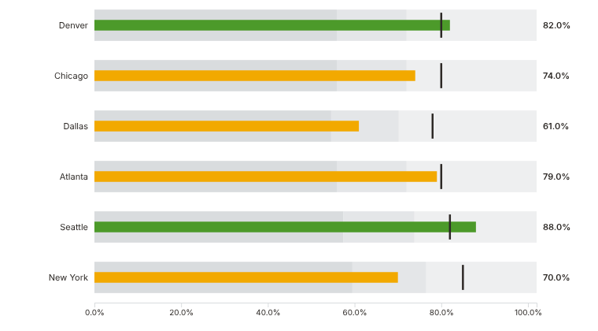
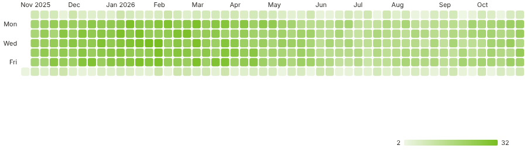
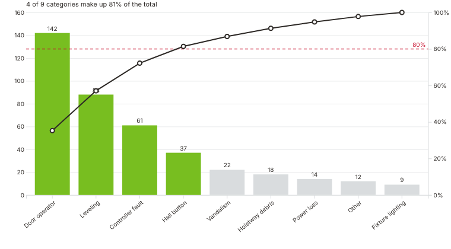
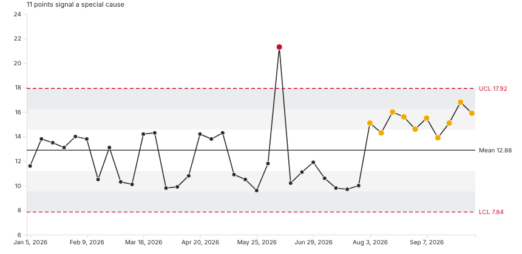
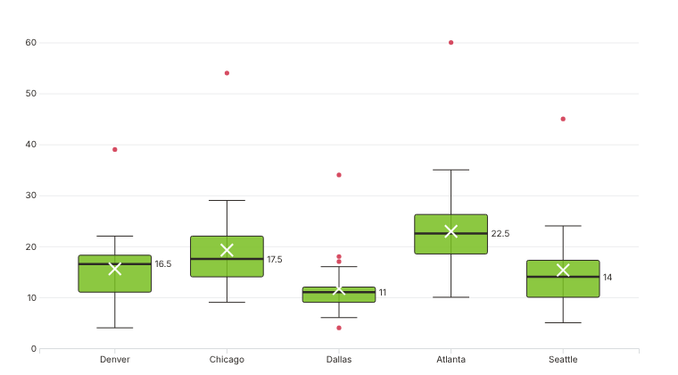
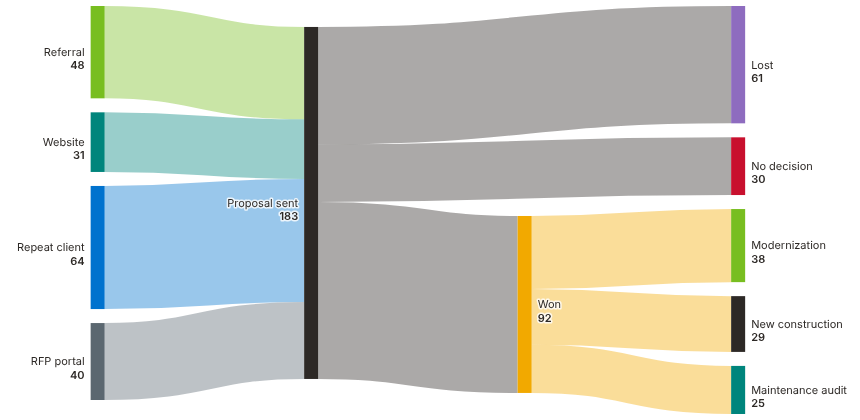
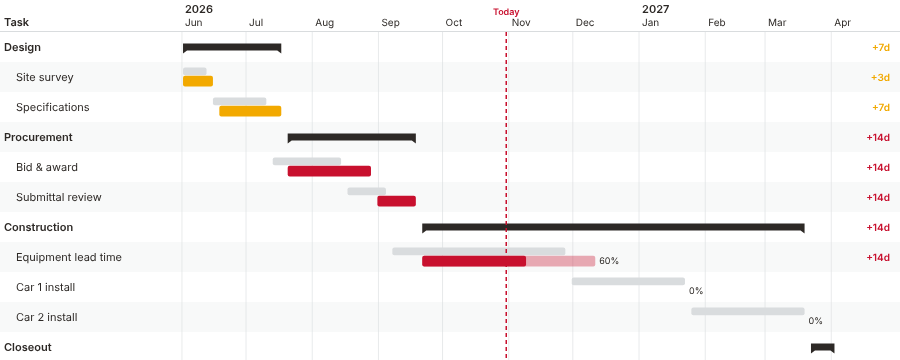
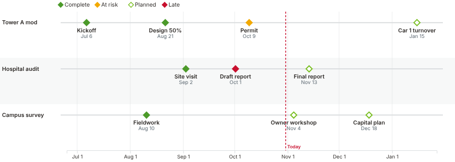
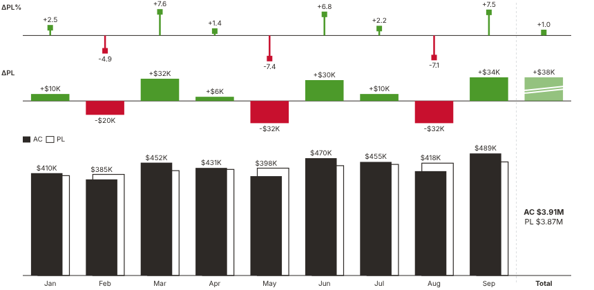
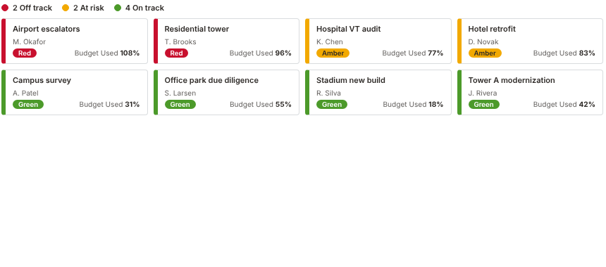

# Lerch Bates custom Power BI visuals

Ten custom Power BI visuals for chart types Power BI doesn't include out of the box. They're built for operations staff, project managers and leadership, and they're generic: each one works with any data that has the right shape, not only elevator data.

**New to Power BI?** Start with **[docs/SETUP-GUIDE.md](docs/SETUP-GUIDE.md)**. It goes step by step from installing Power BI Desktop to a working chart, using the sample data in `samples/`.

| | Visual | What it answers | Main users |
|---|---|---|---|
|  | **[LB Bullet Chart](docs/VISUAL-CATALOG.md#1-lb-bullet-chart)** | Are we hitting target, and by how much? | Office leads, department managers |
|  | **[LB Calendar Heatmap](docs/VISUAL-CATALOG.md#2-lb-calendar-heatmap)** | Which days and seasons are busiest? | Operations, resource planners |
|  | **[LB Pareto Chart](docs/VISUAL-CATALOG.md#3-lb-pareto-chart)** | Which few causes drive most of the problem? | QA/QC, service managers, account leads |
|  | **[LB Control Chart (XmR)](docs/VISUAL-CATALOG.md#4-lb-control-chart-xmr)** | Is this a real change or normal noise? | Operations, quality, process owners |
|  | **[LB Box & Whisker](docs/VISUAL-CATALOG.md#5-lb-box--whisker)** | How consistent are we? Where are the outliers? | Managers, estimators, analysts |
|  | **[LB Sankey Flow](docs/VISUAL-CATALOG.md#6-lb-sankey-flow)** | Where does the work, money or pipeline go? | Business development, finance, leadership |
|  | **[LB Baseline Gantt](docs/VISUAL-CATALOG.md#7-lb-baseline-gantt)** | Which tasks are slipping against the baseline? | Project managers, PMO |
|  | **[LB Milestone Timeline](docs/VISUAL-CATALOG.md#8-lb-milestone-timeline)** | What's due across all projects, and what's at risk? | PMs, principals, clients |
|  | **[LB Plan vs Actual Variance](docs/VISUAL-CATALOG.md#9-lb-plan-vs-actual-variance)** | How far ahead of or behind plan are we? | Finance, office and regional leaders |
|  | **[LB Portfolio Status Grid](docs/VISUAL-CATALOG.md#10-lb-portfolio-status-grid)** | Which projects need attention right now? | PMO, executives, operations reviews |

The research behind this selection, including what Power BI now covers natively, is in **[docs/RESEARCH.md](docs/RESEARCH.md)**.

## What's in this repo

| Path | Contents |
|---|---|
| `dist/*.pbiviz` | **Ready-to-import visual files.** These are what you load into Power BI. |
| `samples/*.csv` | One sample dataset per visual, for trying each visual out |
| `theme/LerchBates.theme.json` | Power BI report theme with brand colours, fonts and defaults for the LB visuals |
| `docs/` | Setup guide, per-visual catalogue, research notes, screenshots |
| `visuals/<name>/` | Source code for each visual (TypeScript + D3) |
| `shared/` | Code shared by every visual: brand colours, tooltips, selection, formatting |
| `tools/` | Build, icon, sample-export and headless render-test scripts |

## Quick start (5 minutes)

1. Install **Power BI Desktop** (free, from the Microsoft Store or microsoft.com/power-bi).
2. **Get data → Text/CSV** → pick a file from `samples/` → **Load**.
3. In the **Visualizations** pane, click **…** → **Import a visual from a file** → pick the matching file from `dist/`.
4. Click the new LB icon in the Visualizations pane, then drag fields into its wells. Each visual shows a checklist of the fields it needs until you've filled them.
5. Optional: **View → Themes → Browse for themes** → `theme/LerchBates.theme.json`.

[docs/SETUP-GUIDE.md](docs/SETUP-GUIDE.md) has the full walkthrough and troubleshooting, plus how to share the visuals company-wide (that needs a Power BI admin).

## Branding

All visuals use one shared Lerch Bates palette (`shared/brand.ts`). There are three ways to change it:

1. **Per visual, no code:** Format pane → **Brand colors**.
2. **Per report, no code:** apply `theme/LerchBates.theme.json`. It sets chart series colours and fonts, and tries to set the LB visuals' brand colours.
3. **At the source:** edit `shared/brand.ts` and run `npm run build`.

> ⚠️ **The hex values are placeholders.** Public sources confirm the 2022 identity uses "LB Bright Green", but no official hex code was published that I could find, and lerchbates.com couldn't be reached from the build environment. Get the official values from Marketing, then update `shared/brand.ts` and `theme/LerchBates.theme.json`. See [docs/SETUP-GUIDE.md#branding](docs/SETUP-GUIDE.md#7-branding).

## Common features (all 10 visuals)

- Native Power BI **tooltips**, including a **Tooltips** well for extra fields
- **Cross-filtering**: click a mark to filter the rest of the page (Ctrl+click selects several), right-click for the context menu
- **Keyboard** focus (Tab, then Enter/Space to select) and **high-contrast mode** support
- **Landing page**: until the required fields are filled in, the visual lists what it needs
- Number formats come from your data model (currency, %, decimals)
- No external network calls, and no data leaves the report (`privileges: []`)

## Building from source

Requires Node.js 18 or later (built with Node 22 and `powerbi-visuals-tools` 7.2.1).

```bash
npm install
npm run build          # lint + package all 10 visuals into dist/
npm run test:render    # headless render test with sample data -> docs/img/*.png
node tools/build-all.mjs bullet-chart   # build one visual
```

To bump the version, edit `tools/version.json` (Power BI uses four parts, e.g. `1.0.1.0`) and rebuild. Power BI only replaces an imported visual when the version number goes up.

Live development with `pbiviz start` (hot reload in the Power BI service) is covered in [docs/SETUP-GUIDE.md#9-for-developers](docs/SETUP-GUIDE.md#9-for-developers).

## Known limitations (read before rolling out)

- **Not yet tested inside Power BI itself.** Every visual builds with Microsoft's official toolchain and passes its lint rules. Each one also renders without errors in a headless browser against a mock Power BI host (normal, empty and high-contrast data, plus tooltip and selection checks); the screenshots above come from that test. But no human has loaded them in Power BI Desktop or the Power BI service yet. Run them through the [checklist](docs/SETUP-GUIDE.md#8-acceptance-checklist) before publishing reports to clients.
- **Highlighting:** when you click another visual, these visuals *filter* (redraw with the subset) rather than *highlight* (dim the rest). Power BI flags highlight support as recommended; it isn't implemented.
- **Localization:** the visuals' own labels are English only. Your data and number formats still follow the report locale.
- **Not certified:** if your tenant only allows *certified* visuals, an admin must add these as organizational visuals. See the setup guide.
- **Native Gantt overlap:** Microsoft released a native Gantt chart in preview in October 2026. LB Baseline Gantt is still useful for planned-vs-actual (baseline) slip analysis; see [RESEARCH.md](docs/RESEARCH.md#native-gantt-preview-october-2026).
- **Theme → custom visual colours:** whether Power BI applies `visualStyles` theme entries to these custom visuals hasn't been verified. If it doesn't, use the Format pane or rebuild with new defaults.
